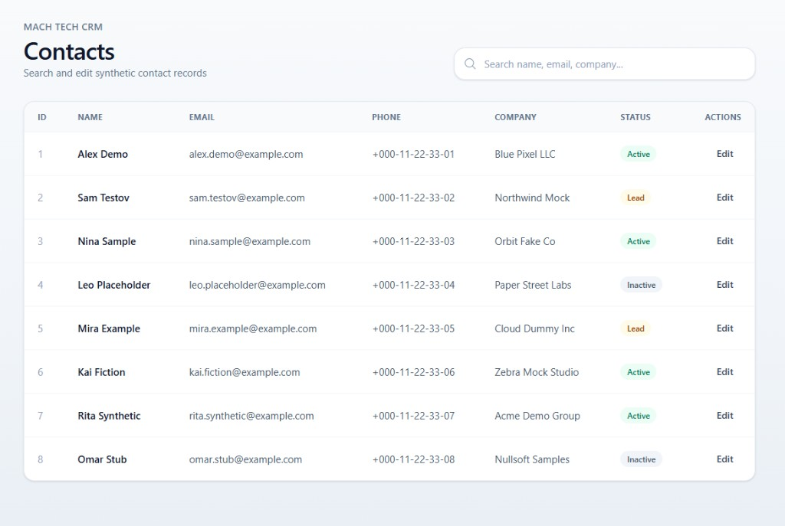

# MACH TECH CRM — Contacts

Adaptive CRM contacts table built with React  
Junior frontend test assignment for **MACH TECH**

<p align="center">
  
  
  
  
  
  
  
</p>

## Preview



## Stack

- React 19
- TypeScript
- Vite
- TailwindCSS 4.3
- pnpm

## Features

- Search by name / email / company
- Contact edit form (modal)
- Validation for required fields and email
- Loading state (Loader)
- Empty state (EmptyState) when nothing is found
- Responsive layout (mobile cards / desktop table)
- Synthetic demo data (not real people)

## Assignment checklist

- [x] Adaptive contacts table (React)
- [x] Search
- [x] Edit form
- [x] Validation
- [x] Loading / empty states
- [x] GitHub repository
- [x] AI tools + design decisions documented
- [x] Synthetic data only

## How to run

```bash
pnpm install
pnpm dev
```

Build:

```bash
pnpm build
pnpm preview
```

## Structure

```
src/
  pages/ContactsPage.tsx   — page logic
  components/              — UI: table, search, form, loader, empty
  data/contacts.ts         — synthetic contacts
  types/contact.ts         — types
docs/
  preview.png              — UI screenshot
```

## Design decisions

1. **List state on the page (`list`)**  
   Initial data from props is copied into `useState` so Save can update the table without a backend.

2. **Search with `filter`**  
   Client-side filtering by name, email, and company; case-insensitive comparison.

3. **Local field copies in the form**  
   On Edit, the form keeps its own `useState` for fields. Save sends the updated object up; Close discards the draft.

4. **Loading via `useEffect` + `setTimeout`**  
   Simulates an API load for 1 second; timer cleanup is included.

5. **EmptyState**  
   Shown when loading is finished and `filtered` is empty.

6. **Responsiveness**  
   Mobile: contact cards. `md+`: table. Header and search adapt by width; modal is a bottom sheet on phones.

7. **Validation**  
   Simple client checks: name/phone/company are required; email must contain `@`.

## AI usage

Cursor (AI assistant) was used for:

- UI layout and Tailwind suggestions
- Explaining React concepts (state, props, filter)
- Help with responsiveness and README

Search, loading/empty, form, validation, and save logic were implemented and refined by me based on those explanations.

## Data

All contacts are fictional (`example.com`, demo names and companies). No real customer personal data was used.
